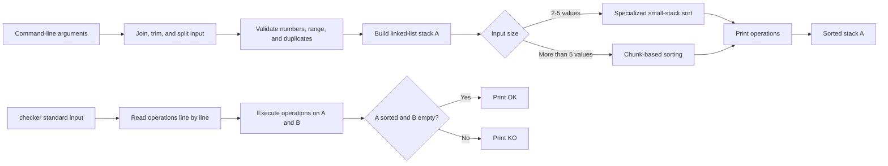

# Push_swap

[](https://github.com/A-chem/42-Cursus-Push_swap)
[](https://42.fr/)

`push_swap` is a 42 project that sorts a sequence of integers using two stacks and a restricted instruction set. The program prints a sequence of operations that transforms stack **A** into ascending order while using stack **B** as auxiliary storage.

The repository also includes the optional `checker` program, which reads operations from standard input and reports whether they correctly sort the supplied numbers.

## Contents

- [Features](#features)
- [How it works](#how-it-works)
- [Project structure](#project-structure)
- [Prerequisites](#prerequisites)
- [Build](#build)
- [Usage](#usage)
- [Allowed operations](#allowed-operations)
- [Checker](#checker)
- [Validation and edge cases](#validation-and-edge-cases)
- [Testing](#testing)
- [Troubleshooting](#troubleshooting)
- [Contributing](#contributing)
- [License](#license)
- [Author](#author)

## Features

- Parses integers supplied as separate arguments or in space-separated argument strings.
- Validates numeric input, signs, integer range, and duplicate values.
- Uses dedicated sorting strategies for 2, 3, 4, and 5 values.
- Uses a chunk-based strategy for larger inputs, with chunk sizes selected for inputs up to 100 values and inputs larger than 100 values.
- Implements the complete `push_swap` instruction set, including combined operations.
- Provides the bonus `checker` executable for validating an operation sequence.
- Includes explicit cleanup helpers for allocated input strings, arrays, and linked-list stacks.

## How it works

The mandatory program performs the following high-level steps:

1. Combines command-line arguments into one input string.
2. Splits and validates the numbers.
3. Rejects malformed values, out-of-range values, and duplicates.
4. Builds stack A as a linked list; stack B starts empty.
5. Selects a sorting strategy based on the number of values.
6. Prints the operations needed to sort stack A.
7. Releases allocated memory before exiting.

For larger inputs, the implementation copies the values into a sorted array, uses their positions to drive chunk-based moves between the stacks, and then moves the largest values back from stack B to stack A.



## Project structure

```text
.
├── Makefile                         # Mandatory and bonus build targets
├── Mandatory/
│   ├── include/push_swap.h          # Stack, input, operation, and sorting declarations
│   ├── src/
│   │   ├── push_swap.c              # Program entry point and strategy selection
│   │   ├── input_valid.c             # Input validation and duplicate detection
│   │   ├── init_stack.c              # Linked-list stack construction
│   │   └── sorting.c                 # Small-input and chunk-sort orchestration
│   ├── operations/                   # Stack operations: swap, push, rotate, reverse rotate
│   └── utils/                        # Parsing, memory, stack, and sorting helpers
├── Bonus/
│   ├── include/                     # Checker and get-next-line declarations
│   ├── src/
│   │   ├── checker_bonus.c           # Checker entry point
│   │   ├── input_valid_bonus.c       # Checker input validation
│   │   ├── init_stack_bonus.c        # Checker stack construction
│   │   └── read_execution_bonus.c    # Read, parse, execute, and verify operations
│   ├── operations_bonus/             # Bonus versions of stack operations
│   ├── utils_bonus/                  # Checker helpers and memory utilities
│   └── get_next_line_bonus/          # Line reader used by checker input
├── README.md
└── Subject.pdf                       # Project subject supplied with the repository
```

## Prerequisites

The project is written in C and is built with the C compiler command configured in the Makefile:

- A Unix-like environment.
- `make`.
- A C compiler available as `cc`.

The Makefile compiles with:

```text
-Wall -Wextra -Werror
```

No external libraries, databases, services, package managers, or environment variables are required by the repository.

## Build

Clone the repository and build the mandatory executable:

```bash
git clone https://github.com/A-chem/42-Cursus-Push_swap.git
cd 42-Cursus-Push_swap
make
```

Build the bonus checker as well:

```bash
make bonus
```

Available Make targets:

| Target | Description |
| --- | --- |
| `make` or `make all` | Build `push_swap`. |
| `make bonus` | Build `checker`. |
| `make clean` | Remove object files. |
| `make fclean` | Remove object files and executables. |
| `make re` | Clean and rebuild the mandatory executable. |

## Usage

### Sort integers with `push_swap`

Pass integers directly as arguments:

```bash
./push_swap 3 2 1
```

Space-separated input strings are also accepted:

```bash
./push_swap "3 2 1"
```

The program writes one operation per line to standard output. If the input is already sorted, no operations are printed.

### Validate a generated sequence

Build the bonus target, generate operations, and pipe them into `checker`:

```bash
make bonus
ARG="3 2 1"
./push_swap $ARG | ./checker $ARG
```

The checker reads operations from standard input and prints:

- `OK` when stack A is sorted and stack B is empty.
- `KO` otherwise.

## Allowed operations

The programs operate on two stacks, A and B. Stack A is initialized from the input and stack B starts empty.

| Operation | Meaning |
| --- | --- |
| `sa` | Swap the first two elements of stack A. |
| `sb` | Swap the first two elements of stack B. |
| `ss` | Apply `sa` and `sb` together. |
| `pa` | Push the top element of B onto A. |
| `pb` | Push the top element of A onto B. |
| `ra` | Rotate A upward: the first element becomes the last. |
| `rb` | Rotate B upward. |
| `rr` | Apply `ra` and `rb` together. |
| `rra` | Reverse-rotate A: the last element becomes the first. |
| `rrb` | Reverse-rotate B. |
| `rrr` | Apply `rra` and `rrb` together. |

## Checker

The bonus executable consumes newline-separated operations from standard input. It validates each instruction, applies it to the two stacks, and checks the final state.

Example with an explicit operation sequence:

```bash
printf "sa\n" | ./checker 2 1
```

Expected result:

```text
OK
```

Invalid input or invalid operation sequences are handled by the checker’s error path rather than being treated as a successful sort.

## Validation and edge cases

The input validation code checks for:

- Empty arguments.
- Invalid characters and malformed signs.
- Values outside the supported integer range.
- Duplicate integer values.
- Inputs containing no sortable values.

For valid inputs, the implementation has dedicated paths for one value, two values, three values, four values, and five values. Larger inputs use the chunk-based path.

## Testing

The repository does not include an automated test suite or a dedicated test target in the Makefile. A practical manual check is:

```bash
make re
make bonus
ARG="3 2 1 6 5 4"
./push_swap $ARG | ./checker $ARG
```

The checker should print `OK` for a valid sequence. Additional manual checks should include already sorted values, negative values, duplicate values, malformed input, and a single quoted argument containing multiple numbers.

To inspect the generated operation count during manual testing:

```bash
ARG="3 2 1 6 5 4"
./push_swap $ARG | tee /tmp/push_swap.operations | wc -l
./checker $ARG < /tmp/push_swap.operations
```

## Troubleshooting

### `make` fails because `cc` is unavailable

Install a C toolchain for your operating system and ensure the `cc` command is available on `PATH`. The Makefile invokes `cc` directly.

### The program prints an error for a seemingly valid input

Check for duplicate values, malformed signs, non-numeric characters, or values outside the integer range. Both executables accept either multiple arguments or one argument containing space-separated numbers.

### The checker prints `KO`

`KO` means that the supplied operations did not leave stack A sorted with stack B empty. Confirm that the operations were generated for the same input passed to `checker` and that the complete operation stream was piped to standard input.

### Object files or executables are stale

Run a full clean rebuild:

```bash
make fclean
make
make bonus
```

## Contributing

Contributions are welcome. Before opening a pull request:

1. Fork the repository.
2. Create a focused branch:

   ```bash
   git checkout -b feature/your-change
   ```

3. Make the change while preserving the existing C style and compiler-warning policy.
4. Rebuild both targets:

   ```bash
   make re
   make bonus
   ```

5. Manually validate representative inputs with `checker`.
6. Commit with a clear message and open a pull request describing the change and how it was tested.

Please do not commit generated object files or compiled executables.

## License

No license file is currently present in the repository. Until a license is added, the project should be treated as **all rights reserved**.

## Author

Created and maintained by [A-chem](https://github.com/A-chem).

The source headers identify the author as `achemlal`.

## Acknowledgments

- [42](https://42.fr/) for the Push_swap project specification and learning framework.
- The repository’s bundled [`Subject.pdf`](Subject.pdf) for the project requirements.
